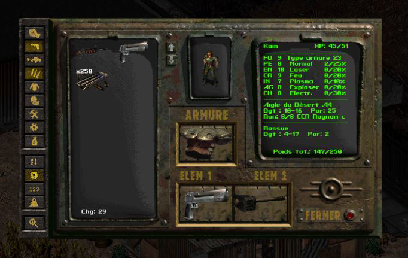
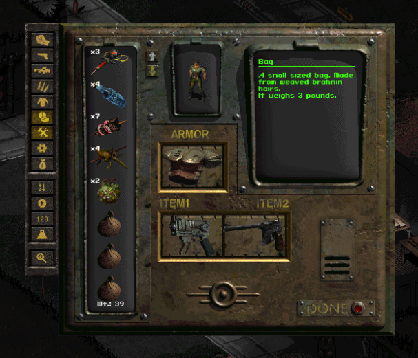

# InventoryFilter

Version 2.4. A standalone fork of the InventoryFilter mod for Fallout 2 / sFall. It runs on sFall 4.2.9 or later (tested on 4.4.8) and on sFall 5.0.9 or later (tested on 5.1.6.1).

## Screenshots

sFall 5 with the two-column inventory (`ExpandInventory=1`), game in French: the weapons filter is on, the filter, sort and search buttons are the two strips beside the item list, and the weight of the shown items is under the list.



sFall 4 with the standard one-column inventory, game in English: the tools filter is on.



## Features

- Category filters (melee weapons, light/thrown weapons, heavy/energy weapons, ammunition, armor, drugs, tools, custom, miscellaneous) on the player's inventory and on the one of the trader, container or party member. Middle click or Ctrl adds a category to the selection.
- Sorting by name, price, quantity or weight. Releasing a filter or a sort brings the original order back. With the two-column inventory of sFall 5 (`ExpandInventory=1`) the sorted items run across the rows.
- **Ammo search** (last button, player window only): left click = ammunition for the weapon in slot 1 (ITEM1), middle click = ammunition for the weapon in slot 2 (ITEM2), right click = normal inventory. Clicking the same button again (left for weapon 1, middle for weapon 2) also ends the search. The search is not available on the other inventory.
- Drop All / Give All buttons with a text in the language of the game (folder `pcx_locales\<language>`, for English, French, Russian, Czech, German, Hungarian, Italian, Polish, Portuguese and Spanish) or as icons only (`IconOnlyButtons=1` in `InvenFilter.ini`). With icons only, the game's own TAKE ALL button gets an icon too (`frm\invmaup.frm` and `invmadn.frm`, put in place of the game's files at start-up with `fs_copy`, so `UseFileSystemOverride=1` is needed in `ddraw.ini`; sFall 5 turns it on by itself). A language without text pictures uses the icons.
- Weight and caps display, Drop All button, inventory swap with party members, hotkeys. With a filter on, a first click on the swap arrows only warns; a second click, the filter untouched, turns it off and swaps.
- Items moved into a filtered inventory (from a hand or the armor slot, from the other side when looting or bartering, with Drop All) go through the filter again.
- Languages: English, French, Russian, Czech, German, Hungarian, Italian, Polish, Portuguese, Spanish (terms of the Restoration Project translation), Traditional Chinese `cht` (terms of NovaRain's UPU translation, Big5 file), Korean `korean` (CP949 file) and Swedish `swedish`.

## Install

Unzip `InventoryFilterSfall5.zip` (sFall 5) or `InventoryFilterSfall4.zip` (sFall 4) into the game folder: the mod goes to `mods\InventoryFilter.dat`. For sFall to load the global scripts of the mods, `ddraw.ini` must contain:

```ini
GlobalScriptPaths=scripts\gl*.int,scripts\sfall\gl*.int
```

Requirements:

- **sFall 4.2.9** or **sFall 5.0.9** (deduced from the sFall release history, not run on the older versions). Before 5.0.8.5 the "remove inventory object" hook does not report the owner, which the barter weight refresh needs. Outside these versions, or with the wrong build (the sFall 4 build on sFall 5), the mod shows a message and stays off.
- A screen at least 740 pixels wide.
- `AllowUnsafeScripting` is not required. Only the party member's portrait in the swap and the automatic closing of an open bag use it (`AllowUnsafeScripting=1` in the `[Debugging]` section of `ddraw.ini`). Without it the swap works, but the portrait does not change and an open bag must be closed before swapping.
- With sFall 4, `ddraw.ini` needs `UseFileSystemOverride=1` for the language file installation (see `Language` below).

## Settings (`InvenFilter.ini`)

The comments of the file can be rewritten in any of the mod's languages with `TranslateIni.ps1` (see below).

- `Enable`: turns the mod on or off (F11 on the map toggles it).
- `Language=<language folder>`: shows the messages of another language than the game's (`russian_dos` for the DOS font). With sFall 5 this option turns on `UseFileSystemOverride` in sFall's configuration.
- `ToolGroupPids`, `CustomGroupPids`: extra items of the Tools and Custom groups.
- `ShowWeight`, `ShowCaps`, `PercentSize`, `TextColor`: weight and caps display.
- `SmartBarter`, `DropAllButton`, `DropAllButtonKey`, `UseBackImage`, `UseGiveAllImage`, `KeepFilters`.
- `DropAllProtectedCategories` (`custom` by default) and `DropAllProtectedPids`: what Drop All / Give All never moves, whether it is used with the button or the hotkey. The categories are those of the filter buttons (`melee`, `wlight`, `weapon`, `ammo`, `armor`, `drug`, `tool`, `custom`, `misc`, separated by commas); `custom` holds the keys and the items of `CustomGroupPids`. The pids are for single items, quest items for instance. Equipped items and caps are never moved either. The protected items are left out of the capacity check of the target.
- `KeepFilters=1` keeps the player's filters from one screen to the next. The filters of the right inventory are kept separately by kind of target with `KeepLootFilters` (container or body), `KeepCompanionFilters` (party member, looted or bartered with) and `KeepMerchantFilters` (merchant), all 0 by default. None of them is saved in the savegame.
- `MaxItems` (1000 by default, 9999 at most): number of items handled in one inventory by the filters, the sort and the order restoration.
- `SwapParty`, `SwapContainers`, `SwapMaxDistance` (0 = no limit): swap with party members, and the largest distance in hexes at which a member can be swapped with. Members farther away are skipped with a message.
- `SwapBarterOffset`, `SwapLootOffset`, `WeightWinShift`, `OldPosition`: layout.
- `[HotKeys]`: DX scancodes of the hotkeys.

If a script error stops the initialization or the creation of a screen, the mod says so (message 126) instead of staying silent.

## Translating the INI comments

`InventoryFilter.dat\TranslateIni.ps1` and `InvenFilter_comments.json` rewrite the comments of `InvenFilter.ini` in the language of your choice (English, French, Russian, Czech, German, Hungarian, Italian, Polish, Portuguese, Spanish, Traditional Chinese, Korean, Swedish):

```powershell
.\TranslateIni.ps1 -Language french
```

Without `-Language` a menu is shown. `-Path` points to the INI of an installation, `-WhatIf` only simulates. The settings are never modified. The English text of the dictionary is the reference for the other languages.

## Build

```powershell
powershell -NoProfile -ExecutionPolicy Bypass -File .\Compile.ps1                    # both: sFall 5 then sFall 4
powershell -NoProfile -ExecutionPolicy Bypass -File .\Compile.ps1 -Target sfall5     # sFall 5 only
powershell -NoProfile -ExecutionPolicy Bypass -File .\Compile.ps1 -Target sfall4     # sFall 4 only
powershell -NoProfile -ExecutionPolicy Bypass -File .\Compile.ps1 -NoPackage         # no zip
```

- sFall 5: `build\compiled\scripts\gl_InvenFilter.int` and `dist\InventoryFilterSfall5.zip`; sFall 4: `build\sfall4\compiled\scripts\gl_InvenFilter.int` and `dist\InventoryFilterSfall4.zip`.
- `-Trace` builds a variant that logs its steps to `mods\InventoryFilter.dat\InvenTrace.ini` (zips named `..._trace.zip`); delete that file before a new try. Not for normal use.
- `Check.ps1` (run by `Compile.ps1` after a packaged build, `-NoCheck` to skip it) checks the data against the sources: every message id of the code in every `.msg` file, every INI key the code reads in `InvenFilter.ini` (and the default given in the code equal to the shipped value), every INI comment block in the dictionary in every language, and the zips of `dist` (entry names with `/`, compiled script and INI in them).
- Compilers: `tools\sslc-sfall5` (sFall 5, GitVerse) and `tools\sslc-sfall4` (sfall-team).

## Known limits

- Party swap: the equipment is not swapped. An item of the member equipped by the player stays with the player when swapping back, and the player's own item taken off goes to the member. In barter, what lies on the player's offer table goes back to the inventory when the swap is made.
- The filters are applied again after a move only when the game reports it (hooks 9 and 24). A move the game does not report is shown unfiltered until the next click or move.

## Source layout

- `source\gl_InvenFilter.ssl`: entry point (`start`, initialization, hooks, window lifecycle). It includes the modules.
- `defs.h`: named constants and macros (`SideGet`/`SideSet` for the per-side state, `IniGet` for the INI file, `Trace` for diagnostics). `InvenFilter.h`: shared prototypes and global variables.
- `filter_logic.ssl` (categories, filtering), `ui_buttons.ssl` (buttons, clicks, tooltips), `sort_logic.ssl` (sorting, original order), `hotkeys.ssl`, `barter_loot.ssl` (weights, hooks, Drop All), `party_swap.ssl`.
- `compat_sfall5.ssl` / `compat_sfall4.ssl`: the same `Compat*` procedures for each sFall generation; the build includes one of them.

## Differences on sFall 4

- The Drop All button is a picture drawn in the inventory window (a window of its own went blank when the game redrew the loot screen) and its clicks, like those on the filters, the sort and the search, are found by the mouse position in the mouse hook; a pressed button is shown by recreating it with other pictures.
- With `ExpandInventory=1` / `ExpandBarter=1` (taller windows in sFall 4.4.4 and later) the weight and filter positions follow the real window height.
- There is no total weight hook: the weight shown by the engine panel leaves out the items hidden by a filter.
- SmartBarter ignores what the other scripts of the barter price hook returned.
